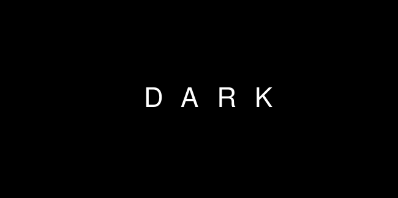

<div align="center">



# DARK

**Windows DFIR Timeline Analyzer**

*Parse, correlate and visualize forensic artifacts in a single dark-themed timeline.*


</div>

---

## Summary

**DARK** is a desktop DFIR (Digital Forensics & Incident Response) tool that ingests Windows forensic artifacts — **Prefetch, LNK, JumpLists, Amcache, UserAssist, BAM, Shellbags, Recycle Bin, RecentDocs and Shimcache** — parses them through a modular backend pipeline, and presents everything in a unified, filterable **Master Timeline**.

Analysts get an interactive **artifact relationship graph**, **high-risk threat scoring**, **AI-powered incident storytelling**, **SHA-256 exports**, and a **Shellbags Explorer** that reconstructs the folder hierarchy with Active / Deleted / Moved / Renamed item status — all in one fast, dark-themed PySide6 application.

---

## Features

- **Master Timeline** — all artifacts merged into one unified, sortable timeline
- **10 modular parsers** — `parsers/` package with a common schema (v1.0)
- **Artifact Relationship Graph** — interactive node/edge graph with keyboard zoom
- **Shellbags Explorer** — folder hierarchy tree + nested item status inspection
- **Threat detection engine** — risk scoring with "High Risk Only" filter
- **AI incident storytelling** — OpenAI-compatible LLM integration (configurable endpoint)
- **Trace Origin** — right-click any event to trace where it came from
- **Regex filtering** — toggle live regular-expression search
- **Full export** — CSV / HTML with SHA-256 integrity header (`Ctrl+E`)
- **Time-range filtering** — datetime pickers for precise windowing
- **Artifact ingestion toggles** — enable/disable each artifact type on load

---

## Requirements

| Component | Version |
|---|---|
| Python | 3.10 or newer |
| OS | Windows 10 / 11 (artifacts are Windows-specific) |
| PySide6 | 6.5+ |
| regipy | 4.0+ (registry hive parsing) |
| pylnk3 | 1.0+ (optional LNK fallback) |
| tabulate | 0.9+ (CLI table output) |

All Python dependencies are listed in [`requirements.txt`](requirements.txt).

---

## Installation

```bash
# 1. Clone the repository
git clone https://github.com/TSL100/dark.git
cd dark

# 2. Create and activate a virtual environment (recommended)
python -m venv .venv
.venv\Scripts\activate          # Windows
# source .venv/bin/activate     # Linux/macOS (GUI requires a desktop session)

# 3. Install dependencies
pip install -r requirements.txt

# 4. Launch the application
python dfir_timeline_ui.py
```

---

## Usage

### Desktop GUI

```bash
python dfir_timeline_ui.py
```

Use the **Ingest** panel to point at your artifact folder, pick the artifact types to parse, then explore the tabs: **Master Timeline**, **Timeline Table**, **Executions**, **Loaded Files**, **Metadata**, **Shellbags Explorer**, **Event Inspector**, and the **Artifact Relationship Graph**.

### CLI Orchestrator

```bash
# List available parsers
python orchestrator.py --list

# Run every parser over an artifact directory
python orchestrator.py --all -o parsed_output /path/to/artifacts/

# Run selected parsers
python orchestrator.py --select prefetch lnk bam -o output /path/to/artifacts/

# Merge parsed outputs into a single unified timeline
python orchestrator.py --merge parsed_output --merge-output unified.json
```

Every parser emits the same **schema v1.0** (`timestamp`, `source`, `event_type`, `artifact_name`, `target_path`, `machine_id`, `details`), so the GUI consumes CLI output with no extra conversion.

---

## Project Structure

```
dark/
├── dfir_timeline_ui.py        # PySide6 GUI application
├── orchestrator.py            # CLI: run, select and merge parsers
├── requirements.txt
├── assets/
│   └── logo.svg
└── parsers/
    ├── base.py                # BaseParser, ArtifactEvent, schema v1.0
    ├── prefetch.py            # Prefetch (.pf execution evidence)
    ├── lnk.py                 # LNK shortcuts
    ├── jumplist.py            # JumpLists (automatic / custom)
    ├── amcache.py             # Amcache program execution
    ├── userassist.py          # UserAssist GUI program launches
    ├── bam.py                 # BAM background activity monitor
    ├── shellbag.py            # Shellbags folder hierarchy
    ├── recyclebin.py          # Recycle Bin $I/$R deleted files
    ├── recentdocs.py          # RecentDocs MRU
    └── shimcache.py           # AppCompatCache execution shim
```

---

## Supported Artifacts

| Artifact | Source | Insight |
|---|---|---|
| Prefetch | `C:\Windows\Prefetch` | Program execution + run counts |
| LNK | Recent / JumpLists | File access from user actions |
| JumpLists | `AppData\...\Recent` | Automatic & custom destination lists |
| Amcache | `Root\InventoryApplicationFile` | Installed/ran program inventory |
| UserAssist | `NTUSER.DAT` | GUI program launch counts + timestamps |
| BAM | `SYSTEM` hive | Background process execution |
| Shellbags | `NTUSER.DAT` | Browsed folder hierarchy (incl. deleted) |
| Recycle Bin | `$Recycle.Bin` | Deleted files with original paths |
| RecentDocs | `NTUSER.DAT` | Recently opened documents |
| Shimcache | `SYSTEM` hive | Execution compatibility cache |

---

<div align="center">
<sub>DARK — built for DFIR analysts. Parse fast, correlate everything, tell the story.</sub>
</div>
